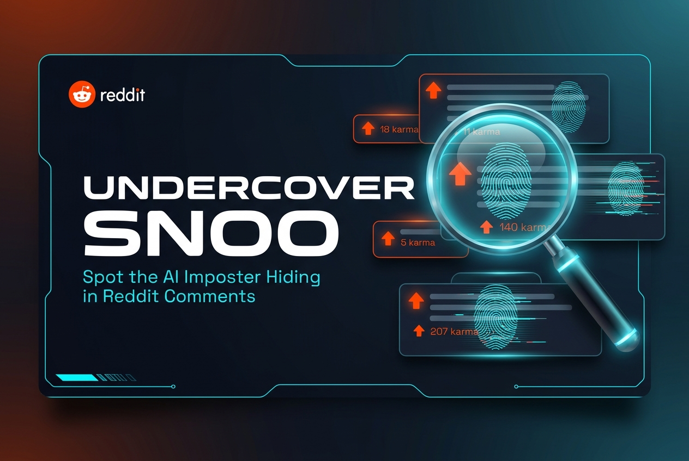
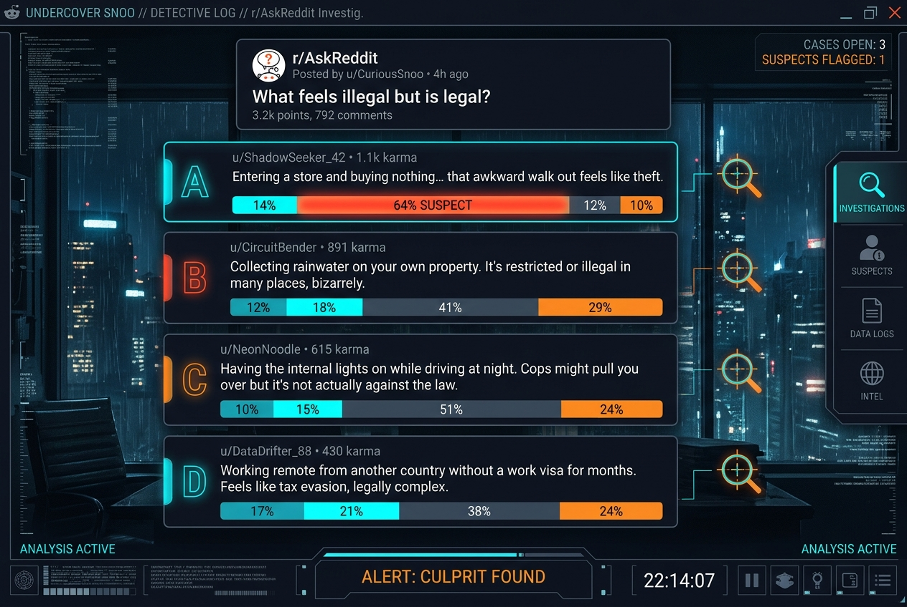

<div align="center">

# 🕵️‍♂️ UNDERCOVER SNOO
### Daily AI Imposter & Community Consensus Game for Reddit

[](https://developers.reddit.com/)
[](https://react.dev/)
[](https://www.typescriptlang.org/)
[](https://tailwindcss.com/)
[](https://developers.reddit.com/docs/redis)
[](https://developers.reddit.com/docs/telemetry)

<br/>

**A daily 60-second social deduction and Turing-test game where Redditors spot the AI bot disguised among authentic high-karma comments.**

[🎮 Play Live Demo on Reddit](https://www.reddit.com/r/undercoversnoo_2026/comments/1xwxsml/welcome_to_rundercoversnoo_2026_official/) • [🏆 Devpost Submission](https://devpost.com) • [🛠️ Devvit App Dashboard](https://developers.reddit.com/apps/undercover-snoo)

<br/>



</div>

---

## 💡 Concept & The "Reddit-y" Problem

With generative AI models increasingly mimicking human writing styles across the web, the **Reddit Game of the Day Hackathon 2026** inspired us to ask:  
*Can a subreddit’s collective intuition tell an authentic Redditor apart from an undercover AI bot?*

**Undercover Snoo** is a daily 60-second social deduction Turing-test:
* Every midnight UTC, Redditors are dropped into an active crime scene from an iconic Reddit thread (r/AskReddit, r/Showerthoughts, r/explainlikeimfive, r/TIFU, etc.).
* Four comments are presented under identical Reddit UI formatting.
* **3 are authentic high-karma comments** from real Redditors.
* **1 is an Undercover Snoo**—an AI bot attempting to blend in using slightly uncanny, robotic phrasing.
* When players cast their accusation, real-time **Devvit Redis counters** reveal the entire subreddit's voting consensus, sparking immediate discussion in the post's comment thread.

---

## 📸 Visual Showcase

| 1. Live Investigation & Card Grid | 2. Consensus Heat-Map & Bot Reveal |
| :---: | :---: |
|  |  |
| **Tactile 2x2 Comment Dossier:** Authentic karma badges, usernames, and thread prompt. | **Atomic Subreddit Consensus:** Real-time voting percentages and hilarious AI tell notes. |

---

## ✨ Core Mechanics

### 1. 📅 10-Year (3,650-Day) Curated Scenario Bank
Built with multi-genre historical Reddit scenarios spanning r/AskReddit, r/Showerthoughts, r/gaming, r/technology, and r/TIFU. A 32-bit deterministic date hashing algorithm (`src/server/scenarios.ts`) maps every calendar day from `2026-11-13` to `2036-11-13` to a unique daily investigation with seed-based Fisher-Yates card shuffling (guaranteeing the bot isn't always in position D).

### 2. 🌡️ Real-Time Consensus Heat-Map (Devvit Redis)
When a player votes for a card, `redis.hIncrBy` increments that suspect's accusation counter. Each card dynamically displays the percentage of the subreddit that suspected that comment:
* `68% Accusations`: Community consensus target.
* `12% Accusations`: Unsuspecting comments.

### 3. 🦅 The Maverick Detective Bonus
* **Standard Capture:** Identifying the imposter awards **1,000 pts**.
* **Maverick Detective (+250 pts):** Awarded when you correctly spot the bot while over **65% of the subreddit was fooled** by the human comments!

### 4. 💬 1-Click Viral Comment Loop
Upon solving, a single click on **"Post Badge to Comments"** triggers `reddit.submitComment`, sharing a spoiler-free investigation verdict directly into the Reddit post thread:
```text
🕵️‍♂️ Undercover Snoo Daily #1 — 2026-11-15
Verdict: 🔍 IMPOSTER CAUGHT
Score: 1250 pts | Streak: 🔥 3 days 🦅 Maverick Detective (Beat the Crowd!)
Voted for Comment [C] on r/AskReddit
*(Zero spoilers — launch the interactive investigation in the post above to play!)*
```

### 5. 🎧 Zero-Dependency Web Audio Synthesizer
* **Card Selection:** High-frequency tactile triangle wave click.
* **Imposter Caught:** 4-note ascending harmonic arpeggio (C5-E5-G5-C6) with confetti particles.
* **Fooled by Bot:** Dramatic low-frequency sawtooth buzzer.

---

## 🏗️ Architecture

```mermaid
flowchart TD
    subgraph Reddit Post
        A["📱 Reddit Post Embed (WebView)"]
        B["💬 Comment Thread"]
    end

    subgraph Client (React 19)
        C["Noir Detective UI & 2x2 Grid"]
        D["Web Audio Synthesizer (SFX)"]
        E["Devvit Journeys Telemetry"]
    end

    subgraph Devvit Backend (Hono / Node.js 22)
        F["GET /api/daily (Sanitized Scenario)"]
        G["POST /api/vote (Accusation & Maverick)"]
        H["POST /api/share-comment (Reddit API Bridge)"]
        I["POST /internal/menu/post-create (Mod Tool)"]
    end

    subgraph Devvit Platform
        J[("Devvit Redis (Votes & Streaks)")]
        K["Devvit Scheduler (Midnight Cron)"]
        L["Reddit API Client"]
    end

    A --> C
    C --> D
    C --> E
    C <-->|HTTP| F
    C <-->|HTTP| G
    C <-->|HTTP| H
    G <-->|hIncrBy / incrBy| J
    H -->|submitComment| L
    I -->|submitPost| L
    K -->|submitPost| L
    L --> B
```

---

## 🛠️ Devvit Platform Capabilities

| Capability | Implementation |
| :--- | :--- |
| **Devvit Web** | Full-stack Node.js server with React 19 WebView bundle |
| **Devvit Redis** | Atomic hash increment (`hIncrBy`) for live vote distribution & streaks |
| **Devvit Journeys** | Telemetry tracking with `startJourney()` and `endJourney()` |
| **Devvit Scheduler** | Daily midnight UTC cron (`0 0 * * *`) |
| **Subreddit Menus** | Moderator tool returning strict `UiResponse` schema |
| **Reddit API** | Automated spoiler-free comment submissions via `reddit.submitComment` |

---

## 🚀 Local Development & Playtesting

### 1. Install & Build
```bash
git clone https://github.com/psywarrior1998/undercover-snoo.git
cd undercover-snoo
npm install
npm run build
```

### 2. Devvit Login & Playtest
```bash
devvit login
devvit playtest r/your_test_subreddit
```

---

## 👤 Author & Credits

* **Developer:** [@psywarrior1998](https://github.com/psywarrior1998) (`u/motivationalspaceman`)
* **Built for:** Reddit's Game of the Day Hackathon 2026
* **License:** [MIT License](LICENSE)
